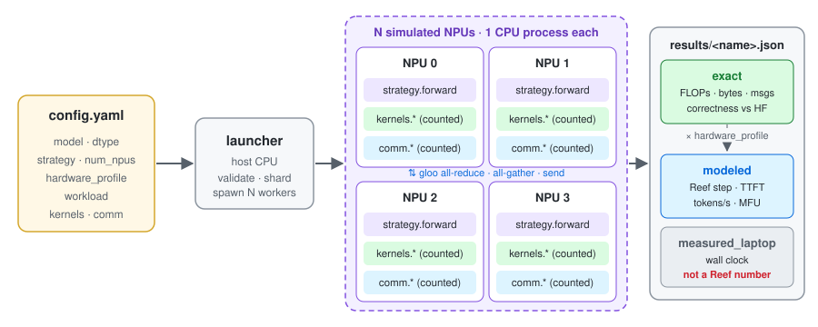
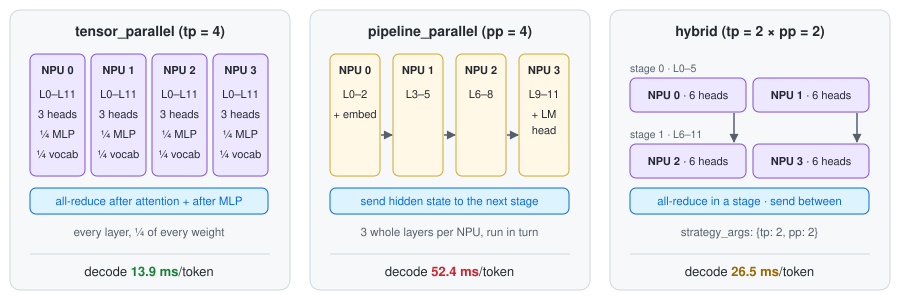
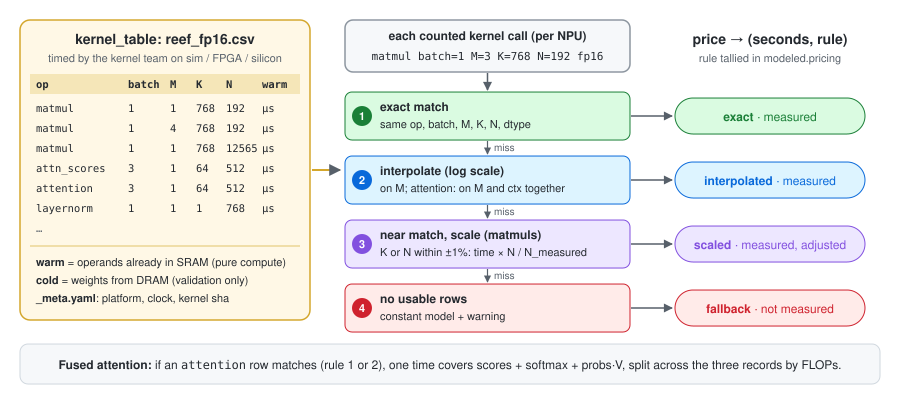

# reef-dist

Config-driven distributed inference for **GPT Neo 125M** on **Reef** (1 host CPU + 1, 2 or 4 NPUs).
The NPUs are simulated as CPU processes. Kernels, interconnect, sharding strategy and compute model
are all pluggable, so real ones drop in without touching the sharding logic.



**The question it answers:** how would each sharding strategy and NPU count perform on Reef?
Every run counts its work exactly, checks it against Hugging Face, and prices it with a hardware
profile. Laptop timings are reported separately and are **never** a Reef estimate.

## Contents

- [Quick start](#quick-start)
- [Input: one YAML config](#input-one-yaml-config)
- [Output: one JSON per run](#output-one-json-per-run)
- [Sharding strategies](#sharding-strategies)
- [Modeled results](#modeled-results)
- [Scripts](#scripts)
- [Pluggable components](#pluggable-components)
- [Kernel lookup table](#kernel-lookup-table)
- [Tests](#tests)
- [Known limits](#known-limits)
- [Full reference](docs/REFERENCE.md)

## Quick start

```bash
uv venv -p 3.11 .venv && uv pip install -p .venv/bin/python -r requirements.txt
.venv/bin/python run.py configs/tp4_decode.yaml        # -> results/tp4_decode.json + summary
.venv/bin/python scripts/compare_results.py results/    # every run side by side
.venv/bin/python -m pytest                              # 71 tests, ~5 min on an M1
```

The first run downloads `EleutherAI/gpt-neo-125m` (~500 MB). CPU only, FP32 math.

## Input: one YAML config

`configs/` has 18 ready-made runs: `{tp1, tp2, tp4, pp2, pp4, hybrid_2x2}` × `{prefill, decode, spec_verify}`.
These are the fields that matter (the rest have defaults):

```yaml
model: EleutherAI/gpt-neo-125m
dtype: fp32                     # fp32 | fp16 (sets byte counts; laptop math stays FP32)
num_npus: 4                     # 1 | 2 | 4
strategy: tensor_parallel       # tensor_parallel | pipeline_parallel | hybrid
strategy_args: {}               # hybrid: {tp: 2, pp: 2}

hardware_profile:               # placeholders until Reef specs arrive
  npu_peak_gflops: 100
  npu_mem_bandwidth_GBps: 10
  compute_model: constant       # constant | table (stub, for kernel-team data)
  matmul_efficiency: 0.5
  link_alpha_us: 5.0            # fixed cost per message
  link_beta_GBps: 10.0
  overlap_comm: false

workload:
  mode: decode                  # prefill | decode | spec_verify
  batch_size: 1
  prompt_len: 512
  gen_tokens: 32                # decode
  draft_tokens: 4               # spec_verify
```

| `mode` | what runs | headline number |
|---|---|---|
| `prefill` | the prompt, in one pass or in `prefill_chunk` chunks | time to first token |
| `decode` | prefill, then `gen_tokens − 1` greedy single-token steps | ms per token |
| `spec_verify` | prefill, then one pass that verifies `draft_tokens` draft tokens | ms per verify pass |

A bad value raises `ConfigError` naming the field.

## Output: one JSON per run

`results/<name>.json` has three result sections:

| section | contents | where it comes from | deterministic |
|---|---|---|---|
| `exact` | correctness vs HF, FLOPs, bytes, messages, weight/KV memory, every kernel shape | counted from tensor shapes | yes |
| `modeled` | **Reef** step time, TTFT, tokens/s, MFU, compute/memory/comm breakdown | `exact` × `hardware_profile` | yes |
| `measured_laptop` | wall-clock median and p90 | `time.perf_counter` | no, sanity checks only |

```text
config, machine
exact
  correctness        max_abs_logit_diff_vs_hf, tokens_match_hf
  per_npu, per_layer flops, bytes, messages, weight_bytes, kv_cache_bytes
  kernel_shapes      every per-NPU kernel shape (the list for the kernel team)
  plan, pass_profiles
modeled
  time_to_first_token_ms, per_token_ms, tokens_per_second, mfu
  per_pass           compute_ms, memory_ms, comm_ms, step_ms, bound_by
  per_layer, passes, pricing
measured_laptop
  median_total_ms, p90_total_ms, per_layer
```

Each run also prints a summary:

```text
== tensor_parallel (tp=4, pp=1) on 4 NPU(s) | decode B=1 prompt=512 | EleutherAI/gpt-neo-125m fp32
   correctness vs HF: max |dlogit| = 0.000217, tokens match = True
   exact (decode, 31 pass(es)): FLOPs=8,116,254,336  msgs=18,972  sent=31.5 MB  max weights/NPU=124.1 MB
   MODELED REEF (constant): step=13.942 ms [compute 1.309 | memory 13.150 | comm 0.792] bound by memory
   TTFT=491.200 ms  per-token=13.942 ms  tokens/s=71.7  MFU=4.7%
   laptop wall-clock (not Reef): median 2331.7 ms, p90 2844.5 ms over 20 runs
```

How the model prices one step on each NPU:

```text
compute = Σ kernel time from the compute model     memory = bytes_read / DRAM bandwidth
comm    = messages × link_alpha + bytes_sent / link_beta
step    = max(compute, memory) + comm              (summed over pipeline stages)
```

## Sharding strategies



| strategy | what is split | communication per forward pass |
|---|---|---|
| `tensor_parallel` | Q/K/V and W_in by columns (whole heads per NPU), W_O and W_out by rows, embedding and LM head by vocab | 2 all-reduces per layer, 1 for the embedding, 1 logits all-gather |
| `pipeline_parallel` | contiguous blocks of layers | 1 send per stage boundary (decode also sends each token back to stage 0) |
| `hybrid` | `pp` stages of `tp`-way tensor parallel | both of the above |

**Hard rule:** strategies only call `kernels.*` and `comm.*`, never `torch`. A test enforces it.

## Modeled results

- **All 18 runs produce the same tokens as HF.** The largest logit difference is 3.6e-4. TP with one NPU and pure PP match the single-device reference bit for bit.
- **Decode is memory-bound**, so splitting the weights is what pays off. TP scales almost linearly: 52.4 → 26.5 → 13.9 ms per token.
- **PP doesn't cut latency** (its stages run one after another), but it does cut weights per NPU: 478 MB on one NPU, 234 MB per NPU with PP4.
- **When TP4 stops winning:** in decode, TP4 stops beating one NPU at a link cost of about 256 µs per message, whatever the efficiency. Use `sweep_hardware.py` to find the crossover for other settings.

These numbers come from placeholder specs. Edit `hardware_profile` and re-price old runs without re-running them.

## Scripts

| script | input | output |
|---|---|---|
| `compare_results.py results/` | result JSONs | strategy × NPUs × workload table (`--measured` adds laptop times) |
| `sweep_hardware.py a.json b.json …` | result JSONs | re-priced results over a link-cost or efficiency range, and where the winner flips |
| `export_kernel_shapes.py results/ -o shapes.csv` | result JSONs | `op, batch, M, K, N, dtype` for every kernel shape, for the kernel team to time |

## Pluggable components

Each component is chosen by name in the config. To add one, drop a file into its package and register the name.

| config key | implemented | stub (planned) |
|---|---|---|
| `kernels` | `torch` | `cpp` (pybind11) |
| `comm` | `local_gloo` | `reef_link` |
| `strategy` | `tensor_parallel`, `pipeline_parallel`, `hybrid` | |
| `hardware_profile.compute_model` | `constant` | `table` (measured kernel times) |

Interfaces are in [docs/REFERENCE.md](docs/REFERENCE.md).

## Kernel lookup table

`compute_model: table` (planned; the stub raises `NotImplementedError` today) replaces the fixed
efficiency with kernel times measured by the kernel team. Each counted kernel call is looked up by
its per-NPU shape, and the rule that priced it is recorded:



In the example, `M = 3` isn't in the table, so it is interpolated between the `M = 1` and `M = 4`
rows. `export_kernel_shapes.py` lists every shape the runs used, which tells the kernel team what to
time. The CSV columns, the shape convention for each op and the grid to measure are in
[docs/REFERENCE.md](docs/REFERENCE.md#compute-model).

## Tests

One test file per milestone. `pytest` runs all 71.

| milestone | checks |
|---|---|
| 0 · reference | the re-implemented GPT Neo matches HF logits bit for bit, with 32 identical greedy tokens |
| 1 · tensor parallel | TP 1/2/4 give the same tokens as the reference; TP with one NPU is bit-identical |
| 2 · counting | unique FLOPs and weight bytes sum to the 1-NPU totals; all-reduce counts and sizes; a hand-calculated decode step |
| 3 · workloads | chunked prefill = whole prefill; decode and spec_verify structure |
| 4 · pipeline / hybrid | PP2, PP4 and hybrid 2×2 correctness and counts; a pass's step = sum of its stages |
| 5 · fused QKV | same tokens and FLOPs as unfused, with 2 fewer kernel calls per layer |
| 6 · measurement | laptop timing, comm ops on real processes, all three scripts |
| architecture | strategies never touch `torch`; stubs fail clearly |

## Known limits

- **Distributed logits drift slightly** (up to ~6e-4) because all-reduces sum in a different order. Tokens are identical; distributed tests use `atol = 1e-3`.
- `dtype: fp16` changes byte counts only. `int8` and `int4` are rejected for now.
- `cpp` kernels, `reef_link` comm and the `table` compute model are stubs that raise `NotImplementedError`.
- On macOS, threads aren't pinned to cores (that works on Linux only), and gloo messages are split into chunks to avoid a macOS transport bug.

**Everything else** (GPT Neo implementation notes, counting conventions, the full output schema, how to extend each component) is in **[docs/REFERENCE.md](docs/REFERENCE.md)**.
